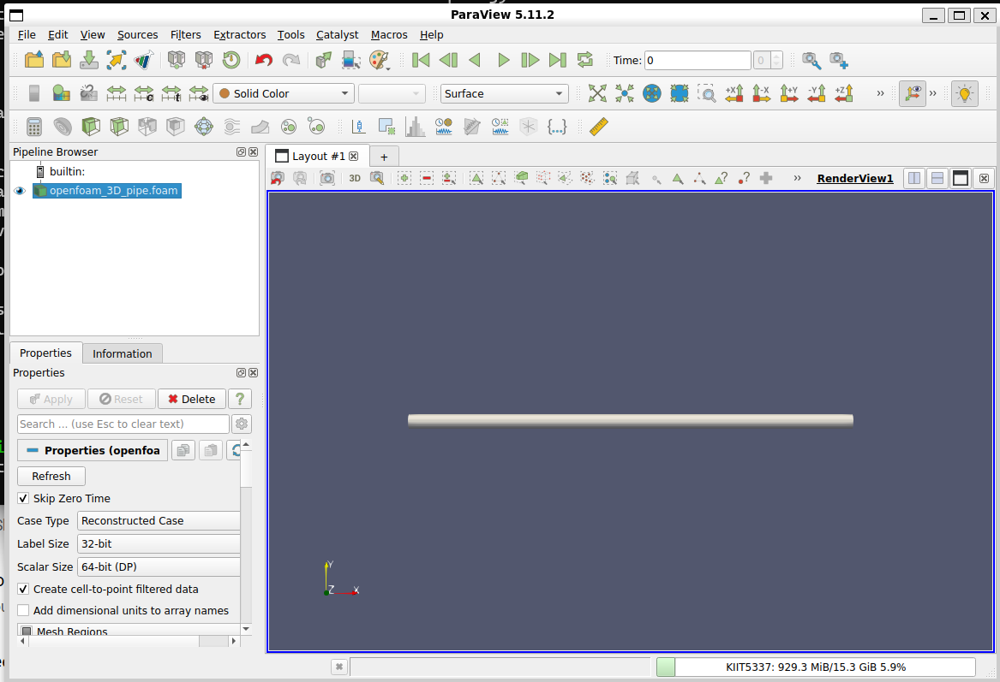
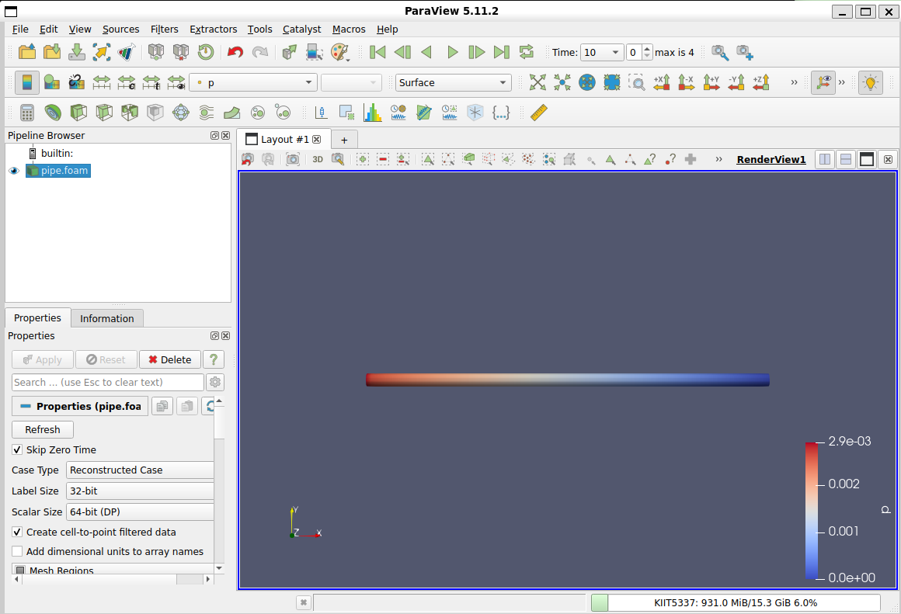
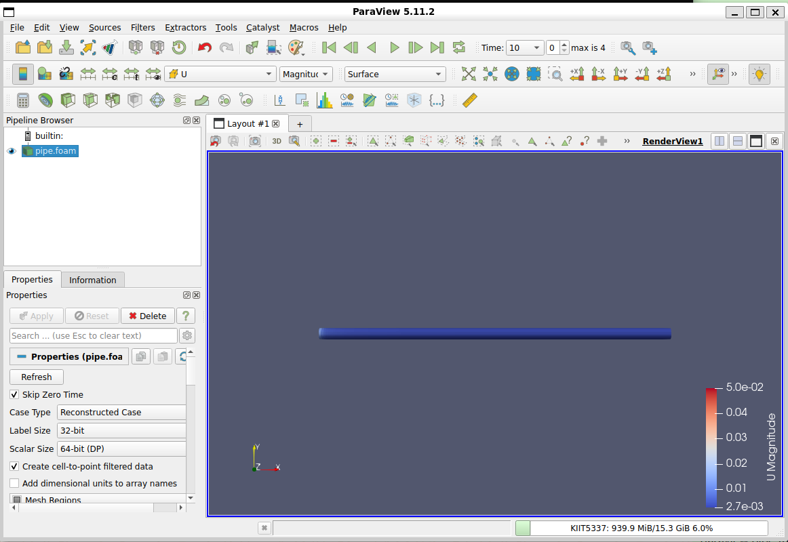
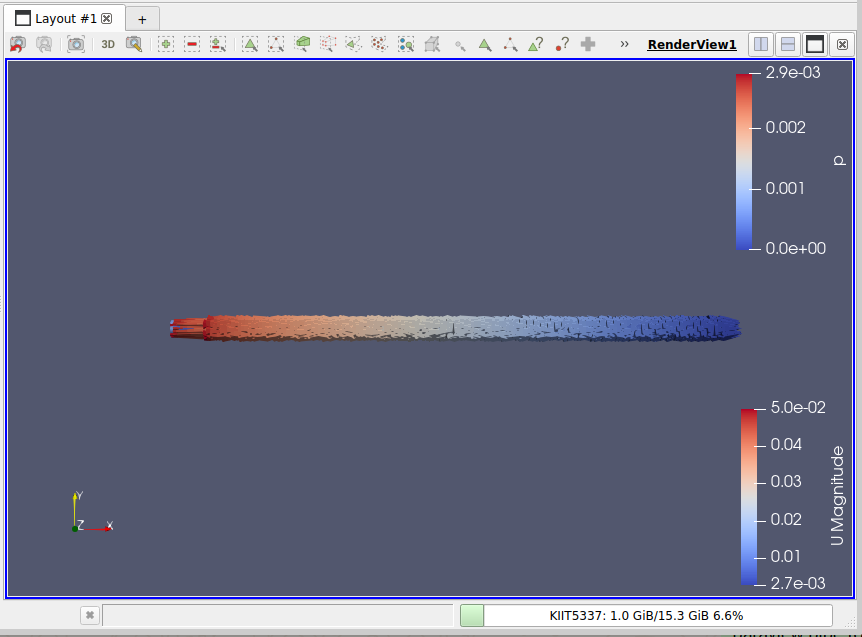

# Hagen-Poiseuille-Flow-Through-a-3D-Pipe-using-OpenFOAM-14
This is a small CFD project where I simulate water flowing through a straight circular pipe in OpenFOAM 14 on Ubuntu. The mesh is built entirely with `blockMesh`, no external CAD. The flow is laminar, so the result can be checked against the textbook Hagen-Poiseuille solution, which is the whole point of the exercise.

I started this from the IIT Bombay FOSSEE / Spoken Tutorial lesson "Creating 3D Pipe Geometry and Mesh in OpenFOAM". That tutorial was written for an older OpenFOAM version, so I had to change a few things to get it working in v14 (the solver setup is the biggest difference, more on that below).

## Problem setup

| Item | Value |
|---|---|
| Fluid | Water |
| Pipe diameter, D | 0.01 m (radius 5 mm) |
| Pipe length, L | 0.3 m, along the x-axis |
| Inlet | Uniform velocity, 0.025 m/s |
| Outlet | Pressure = 0 Pa |
| Wall | No-slip |
| Kinematic viscosity, ν | 1e-06 m²/s |
| Regime | Laminar |

Reynolds number: Re = U·D/ν = 0.025 × 0.01 / 1e-06 = 250. That is well below the pipe-flow transition range, so no turbulence model is needed.

A quick note on pressure. In OpenFOAM 14 the incompressible solver works with kinematic pressure (m²/s²), which is just p/ρ. So the "0 Pa" outlet is simply `0` in the `p` file.

## Mesh

A pipe can't be made well from one single hex block, because the corners of the block end up badly skewed near the round wall. So I used an O-grid: one square block in the middle, wrapped by four curved blocks that reach the wall. The curved edges are defined with `arc` entries in `blockMeshDict`.

- 5 blocks, each 10 × 10 × 150 cells
- 75,000 cells in total
- Patches: `inlet`, `outlet`, `wall`
- Inner square half-width 0.0017 m, outer corner points at R·cos45° = 0.003536 m



## Solver settings

- Application: `foamRun` with the `incompressibleFluid` solver (this is how v14 does it, the old `icoFoam` / `simpleFoam` names from the tutorial are gone)
- Time step 0.02 s, end time 50 s, output every 500 steps (so every 10 s)
- Pressure-velocity coupling through PIMPLE, 1 outer corrector, 2 pressure correctors
- Schemes: Euler in time, `linearUpwind` for the convection term, `linear` for the rest
- Pressure solved with GAMG, velocity with `smoothSolver`

My first controlDict had `deltaT 1`, which is far too big for this mesh and would not have been stable, so I dropped it to 0.02.

## How to run it

Make sure OpenFOAM 14 is sourced first:

```bash
source /opt/openfoam14/etc/bashrc
```

Then set up the case folder and put the files in their places (the .txt files in this repo are the contents of the matching dictionaries):

```bash
mkdir -p ~/openfoam_3D_pipe/{0,constant,system}
cd ~/openfoam_3D_pipe
```

| File in this repo | Where it goes |
|---|---|
| `blockMeshDict.txt` | `system/blockMeshDict` |
| `controlDict.txt` | `system/controlDict` (the first, basic version used for meshing) |
| `solve and write control.txt` | `system/controlDict`, `system/fvSchemes`, `system/fvSolution` |
| `boundary and initial conditions.txt` | `0/U` and `0/p` |
| `physical properties.txt` | `constant/physicalProperties` and `constant/momentumTransport` |

Heads up: the `solve and write control.txt` version of `controlDict` replaces the earlier one.

Build the mesh, check it, and run:

```bash
blockMesh
checkMesh
foamRun | tee log.foamRun
```

`checkMesh` should finish with `Mesh OK` and 75,000 cells. Then open the results:

```bash
touch pipe.foam
paraview pipe.foam
```

If you paste the dictionaries in by hand, use `cat > file << 'EOF'` or a text editor. Pasting raw dictionary text straight into the terminal just makes bash complain, which cost me a few minutes at the start.

## What to expect (analytical check)

For fully developed laminar flow in a circular pipe:

- Centerline velocity = 2 × average velocity = 2 × 0.025 = **0.05 m/s**
- Pressure drop = 32·ν·L·U / D² = **2.4e-03 m²/s²** kinematic, which is about **2.4 Pa** for water (ρ = 1000 kg/m³)

The velocity profile should come out parabolic, zero at the wall and highest at the center. In ParaView, take a slice through the pipe, colour it by `U`, and compare the peak against 0.05 m/s. The pressure difference between inlet and outlet should be close to the value above.

## Results

Contour and vector plots from the final time step:

| Pressure | Velocity |
|---|---|
|  |  |



<!-- Add your own measured numbers here: max velocity and inlet-outlet pressure drop, then compare with the analytical values above. -->

## Repository structure

```
openfoam_3D_pipe/
├── blockMeshDict.txt
├── boundary and initial conditions.txt
├── controlDict.txt
├── physical properties.txt
├── solve and write control.txt
├── paraview.png
├── pressure_contour.png
├── velocity_contour.png
├── velocity_vector.png
└── README.md
```

## Things I'd like to try next

- Refine the mesh (more cells along the radius) and see how the centerline velocity error changes
- Plot the velocity profile at a few axial positions to check when the flow becomes fully developed
- Try a higher inlet velocity and see where laminar assumptions stop making sense

## Credits

- FOSSEE, IIT Bombay, for the Spoken Tutorial this was adapted from
- OpenFOAM Foundation, version 14

## Author

**Pratyush Dash**
B.Tech Chemical Engineering, KIIT University, Bhubaneswar.
